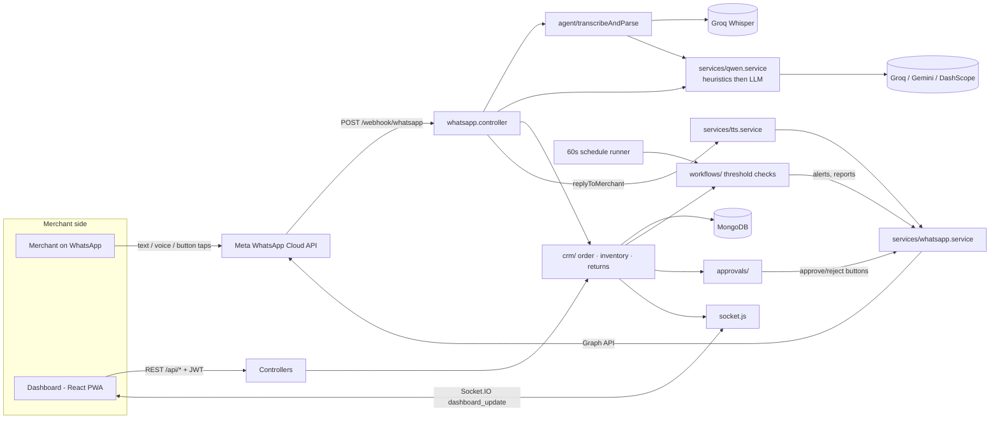
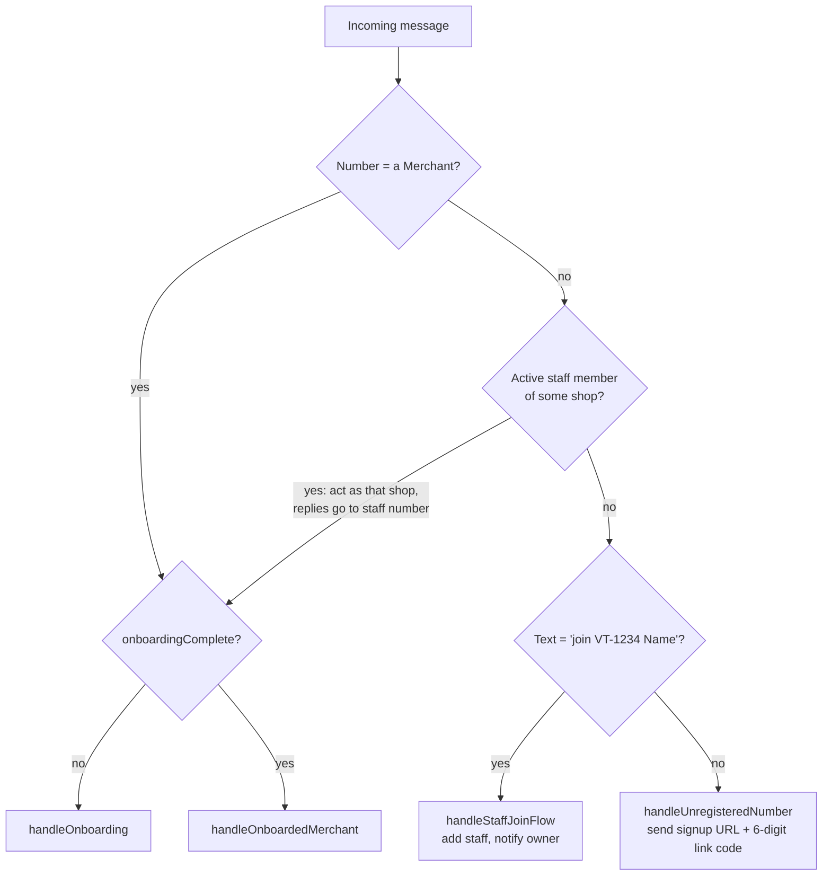
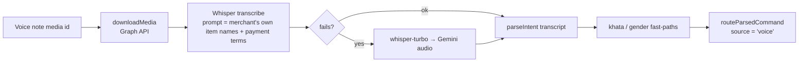
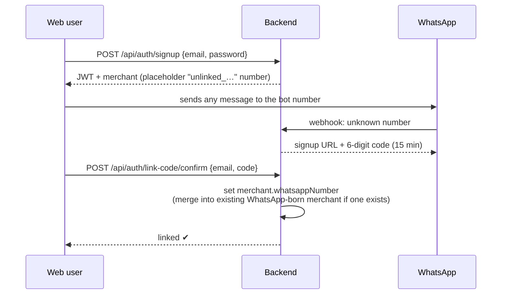

# VerbaTask Backend — Complete Guide

> Written from the code in `backend/` (not from older planning docs). Where this guide and
> [architecture.md](architecture.md) / [VERBATASK_HANDOFF.md](VERBATASK_HANDOFF.md) disagree, the code wins —
> see [§13 Known gaps](#13-known-gaps--things-that-differ-from-older-docs).

---

## 1. What the project is

VerbaTask (branded **BolDukan** in the README and on the frontend) is a **WhatsApp-first shop assistant for small Pakistani merchants**.

- The merchant's main interface is **one shared WhatsApp number**. They tap buttons, type, or send **Urdu / Roman-Urdu / English voice notes**.
- The backend understands what they said, **logs sales, deducts stock, tracks customer credit (udhaar/khata), runs automations, sends PDF reports**, and replies in text *or* a spoken voice note.
- A **React dashboard** (separate `frontend/` app) is a window into the same data. It reads/writes through the REST API and gets live updates over Socket.IO.

Core design rule: **every input path (button flow, typed text, voice note, dashboard form) ends up calling the same functions in `crm/`**, so stock deduction and order creation exist in exactly one place.

---

## 2. Tech stack

| Concern | Choice |
|---|---|
| Runtime / server | Node 22, Express 4, ESM (`"type": "module"`) |
| Database | MongoDB via Mongoose 8 |
| Real-time | Socket.IO 4 |
| Auth | bcryptjs + JWT (7-day), Bearer header **or** cookie |
| WhatsApp | Meta Cloud API, Graph `v20.0` (webhooks in, REST out) |
| Speech-to-text | Groq Whisper (`whisper-large-v3` → `-turbo` → Gemini audio) |
| Language understanding | LLM (Groq-hosted Qwen by default; falls back across Groq models → Gemini → DashScope Qwen) **plus** regex heuristics that run first |
| Text-to-speech | Gemini → ElevenLabs → Edge neural voices (→ Google Translate only if strict mode is off) |
| PDF reports | pdfkit + pdfkit-table |
| Hosting | Fly.io (`fly.toml`, Dockerfile, port 8080) |
| Tests | Node's built-in test runner (`npm test`) |

---

## 3. Folder map (`backend/`)

```
backend/
├── index.js                     Entry point: Express app, CORS, routes, Mongo connect, schedule runner, Socket.IO
├── src/
│   ├── routes/                  One file per resource; only maps URL → controller
│   ├── controllers/             HTTP handlers (+ the giant whatsapp.controller.js)
│   ├── middleware/              requireAuth (JWT), verifyWhatsappSignature (HMAC)
│   ├── models/                  Mongoose schemas
│   ├── crm/                     ★ Business logic: orders, inventory, returns, fuzzy item matching
│   ├── workflows/               Automation engine (rules/validation + runner)
│   ├── approvals/               High-value order approval logic
│   ├── agent/                   Voice note → transcript → structured command
│   ├── services/                External integrations & helpers (WhatsApp, LLM, TTS, reports, media, i18n, cache)
│   ├── dashboard/               Overview aggregation for the dashboard home page
│   ├── constants/               Payment methods, starter catalogs per business type
│   └── socket.js                Socket.IO server + `emitDashboardUpdate()`
├── tests/                       20 test files (`npm test`)
├── scripts/                     One-off generators (CBA docx, user-manual PDF)
├── Dockerfile, fly.toml         Deployment
└── .env.example                 Every env var, with comments
```

---

## 4. Architecture at a glance



Layering convention (from `architecture.md`, mostly followed):
**routes → controllers → crm / workflows / approvals (logic) → models + services (I/O).**

---

## 5. Startup ([backend/index.js](../backend/index.js))

1. Loads `.env`, builds the Express app, sets security headers and CORS (allow-list of the Netlify / boldukan.com origins + `FRONTEND_URL`; anything is allowed outside production).
2. `express.json({ verify })` stores the **raw body** in `req.rawBody` — needed to verify Meta's HMAC signature.
3. Mounts routes (table in §6).
4. Creates the HTTP server and calls `initSocketIO(server)`.
5. Connects to Mongo (`MONGODB_URI`); on success calls `startScheduleRunner()` (workflow scheduler, ticks every 60 s).
6. Listens on `PORT` (default 8080).

---

## 6. API surface

All JSON responses use `{ success: true, data }` or `{ success: false, error: { message } }`.
"Auth" = `requireAuth` middleware (JWT from `Authorization: Bearer …` or session cookies `boldukan_session` / `vt_session` / …).

| Mount | Auth | Purpose |
|---|---|---|
| `GET /health` | – | Liveness check |
| `GET/POST /webhook/whatsapp` | GET: verify token · POST: HMAC signature | Meta webhook (the heart of the bot) |
| `/api/auth` | mixed | `signup`, `login`, `logout`, `link-code/confirm`, `forgot-password/{request,resend,reset}` (public); `me` GET/PATCH (auth) |
| `/api/inventory` | ✔ | List / create(upsert by name, qty is *added*) / patch / delete items |
| `/api/orders` | ✔ | List, get, create; `…/return`, `…/exchange` |
| `/api/reports/whatsapp`, `/api/reports/download/:type` | ✔ | Send a PDF report to WhatsApp / download it |
| `/api/approvals` | ✔ | `GET /` pending, `PATCH /:id/respond` |
| `/api/dashboard` | ✔ | `GET /overview`, `POST /notify-expiries` |
| `/api/workflows` | ✔ | CRUD for automations |
| `/api/customers` | ✔ | Khata customers: CRUD + `POST /:id/settle` |
| `/api/merchant` | ✔ | Profile, payment methods, staff, shop code, phone-number change verification |

---

## 7. Data model (MongoDB)

| Model | Key fields | Notes |
|---|---|---|
| **Merchant** | `whatsappNumber` (unique), `email`, `passwordHash`, `businessName/Type`, `language` (`ur`/`en`), `onboardingComplete`, voice prefs (`voiceReplies`, `voiceGender`, `replyPreference`), `confirmAutomations`, `requireApprovalForHighValue` + `highValueThreshold` (10 000), `acceptedPaymentMethods`, `shopCode` (`VT-1234`), `subscriptionTier`, `staffMembers[]` | One doc = one shop. Email-only signups get a placeholder `unlinked_…` WhatsApp number until linked. |
| **InventoryItem** | `merchantId`, `name`, `quantity` (≥0), `price`, `unit`, `expiryDates[]` (`YYYY-MM`), `aliases[]` | `aliases` are learned spellings ("chawal" → Rice). |
| **Order** | `orderNumber` (`VT-xxxxxx-nnn`), `items[]`, `total`, `paymentMethod`, `customerId/Name`, `source` (`guided`/`voice`/`text`/`dashboard`), `status`, `returnHistory[]`, `exchangeHistory[]`, `incomingMessageId`, `confirmationMessageId`, `staffName/Phone` | Statuses: completed, pending_approval, approved, rejected, returned, partially_returned, exchanged. Message ids let a merchant *reply to* a receipt to return it. |
| **Customer** | `name` (lowercase, unique per merchant), `phone`, `balance` | `balance > 0` = customer owes the merchant (udhaar/khata). |
| **Workflow** | `trigger` (`threshold`/`schedule`/`message`), `condition`, `action`, `active`, `nextRunAt`, `firedItems[]` | Shapes enforced by `workflow.rules.js`. |
| **Approval** | `type`, `refId` (order id), `summary`, `status` | One per high-value order awaiting a decision. |
| **ConversationState** | `whatsappNumber` (unique), `flow`, `step`, `data` | **WhatsApp has no session** — this stores "where is this merchant in a multi-step flow". Flows: `onboarding`, `guided_order`, `item_disambiguation`, `customer_disambiguation`, `return_disambiguation`, `workflow_confirm` (+ `pending_new_item`, `cut_voice_note` used in code). |
| **LinkCode** | `whatsappNumber`, 6-digit `code`, `expiresAt` (15 min), `usedAt` | Connects a web account to a WhatsApp number. |
| **PasswordResetCode**, **PhoneChangeVerification** | codes + expiry | Reset password / change number via WhatsApp-delivered OTP, rate-limited. |
| **Payment** | – | Defined but **not used anywhere** yet (planned for screenshot/OCR reconciliation). |

---

## 8. The WhatsApp pipeline (the core of the product)

Everything lives in [whatsapp.controller.js](../backend/src/controllers/whatsapp.controller.js) (~2 800 lines) and is the thing to understand first.

### 8.1 Inbound request

```
Meta ──POST /webhook/whatsapp──▶ verifyWhatsappSignature (HMAC-SHA256 of rawBody with WHATSAPP_APP_SECRET)
                                  └▶ handleIncomingMessage
```

1. **Reply `200` immediately** — Meta retries aggressively and LLM calls are slow. All real work happens after the response.
2. Ignore non-message events (delivery receipts). **De-duplicate** by `message.id` (in-memory set of the last 1 000 ids).
3. Identify the sender by `message.from`:



### 8.2 Onboarding (new merchant, state machine in `ConversationState`)

`awaiting_language` (button: اردو / English) → `awaiting_business_details` (LLM extracts name, type, location, what they sell; falls back to raw text) → `awaiting_inventory` (LLM parses a stock list; also inserts a **starter catalog** for the business type; "skip" allowed) → `onboardingComplete = true`, state deleted. Voice notes work at every step.

### 8.3 Routing for an onboarded merchant (`handleOnboardedMerchant`)

Checked in this order — first match wins:

1. **Button taps** by id prefix: `approve_/reject_` (order approval), `clearexpiry_`, `pick_` ("did you mean…?"), `cust_same_/cust_new`, `wf_save/wf_cancel`, `set_lang_*`, `set_voice_*`, `menu_*`, `report_*`, `toggle_pay_*`, `pay_*` (payment choice in guided order).
2. **An in-flight guided order** (`ConversationState.flow = guided_order`) swallows the message — unless it's been idle >30 min (auto-expired) or the user says "report"/"cancel".
3. **By message type**
   - `text` → `handleTextMessage`
   - `audio` → `handleVoiceNote`
   - `interactive` list reply → guided order / start
   - `image` → placeholder ("screenshot reconciliation isn't wired up")

### 8.4 Text messages (`handleTextMessage`)

Cheap, deterministic checks first; the LLM is the last resort:

1. A pending "new item needs price/unit" follow-up
2. Keyword commands: `order`/`sale` (start guided flow), `link`/`code`, `help`/`menu`, `stock list`, `report`, `profile`/`settings`, `banks`, `workflows`
3. Settings via text: `set name …`, `set location …`, `set price rice 300`, `voice on/off`, `confirm on/off`, enable/disable a payment method, language switch
4. `aaj ka hisab` (daily summary), `low stock`, `forgot password`, male/female voice switch, khata settle/inquiry, `shop code`, `staff`
5. **User-defined message automations** (`evaluateMessageWorkflows`) — if one fires, skip NLP
6. **`parseIntent(text)`** → `routeParsedCommand`

### 8.5 Voice notes (`handleVoiceNote`)



- Audio capped at 8 MB. Whisper gets a **vocabulary prompt** built from the merchant's catalog so product names transcribe correctly.
- If the sale sounds **cut off** (`isIncomplete`), the items so far are parked in `cut_voice_note` state and the bot asks the merchant to send the rest; the next note is **merged** into the same order.
- Voice automations are **always** read back for Save / Cancel (transcripts get misheard).

### 8.6 Understanding intent (`services/qwen.service.js → parseIntent`)

Order of attempts (fast → slow):

1. Regex heuristics: return/exchange, khata settle, khata inquiry, "money-first" sale ("20 ki chini"), stock restock, standard sale ("2 chawal cash")
2. LLM with a large system prompt that forces **one JSON object**, with the merchant's catalog appended. Provider cascade: Groq models → Gemini → DashScope.
3. Post-guards fix known LLM mistakes (restock misread as sale, khata payment misread as sale) and normalise payment methods.
4. Last-resort regex for greetings / "report" / "stock list".

Intent types produced: `log_sale`, `update_stock`, `stock_guide`, `check_stock`, `create_workflow`, `unsupported_workflow`, `generate_report`, `return_order`, `exchange_order`, `settle_khata`, `check_khata`, `greeting`, `unknown`.

> Typed and spoken input converge in **`routeParsedCommand`** with an identical command shape; downstream code never knows which was used (only `source` is recorded).

### 8.7 Logging a sale — end to end

Three entry points, one engine:

| Entry | How it reaches `crm/order.service.js → createOrder` |
|---|---|
| **Guided buttons** | `order` → item list (paginated 9/page, free-text also accepted) → quantity → payment method buttons → `finalizeGuidedOrder` → `createOrderViaCrm` |
| **Text / voice** | `parseIntent` → `log_sale` → `routeParsedCommand` → `createOrderViaCrm` |
| **Dashboard** | `POST /api/orders` → `createOrder` directly |

`createOrder` does, in order:

1. **Resolve each line to an InventoryItem**: by id (dashboard) → exact name / learned alias → fuzzy + bilingual match (`item-matching.js`, knows chawal ↔ rice ↔ چاول, phonetic spellings) → LLM semantic match (which then **saves the spoken word as an alias**, so the system learns).
2. **Validate stock** for every line *before changing anything* (`INSUFFICIENT_STOCK`); unknown item → `ITEM_NOT_FOUND`.
3. **Deduct stock** (rolls back on a DB error).
4. Run **threshold workflows** for each changed item (low-stock alerts).
5. Compute total (explicit amount wins; price comes from the stock list).
6. If merchant opted in (`requireApprovalForHighValue`) and total ≥ threshold → status `pending_approval`.
7. If payment is **udhaar**: find/create the `Customer` (honorific-tolerant: "soban bhai" = "soban") and **add the total to their balance**.
8. Save `Order`; create `Approval` (sends *Approve / Reject* buttons) if needed; emit a **Socket.IO** update.

Back in the controller, business errors become friendly replies instead of failures:
- Unknown item → **"Did you mean…?"** buttons (state saved in `ConversationState`, the tap finishes the sale)
- Similar customer name on an udhaar sale → "Same customer?" buttons
- Out of stock → localised message

### 8.8 Other commands handled by the same router

| Feature | Where | Behaviour |
|---|---|---|
| Restock ("maal aya 20 chini 150") | `crm/inventory.service.js` | Adds quantity to existing item; a **brand-new item** requires price **and** unit — the bot asks, the next message completes it (`pending_new_item`) |
| Stock check, stock list, set price | `inventory.service.js` | |
| Return / exchange | `crm/return.service.js` | Find order by id / number / **replied-to receipt message**; restock items; reduce khata balance for udhaar orders; track `returnHistory`; status `returned`/`partially_returned`/`exchanged` |
| Khata (credit ledger) | controller + `Customer` | "ali ne 500 diye" settles; "ali ka khata" shows balance with a copy-paste reminder message |
| PDF reports | `services/report.service.js` + `reportDelivery.service.js` | sales, inventory, low-stock, top-selling, expiring → generated in memory → uploaded to WhatsApp media → sent as a document |
| Staff | `merchant.controller` + join flow | Owner shares shop code; staff texts `join VT-1234 Name`; staff sales are tagged with their name |
| Expiry alerts | `services/expiry.service.js` | Items expiring within 45 days → message with "Clear Alert" button |

### 8.9 Replying (`replyToMerchant`)

```
phrases {spoken, text}  ──▶ shouldReplyWithVoice?
        merchant.voiceReplies && replyPreference:
          text_only / voice_on_voice (only if they sent audio) / always_voice
   yes ─▶ tts.service (Gemini → ElevenLabs → Edge; male/female voice) ─▶ upload media ─▶ send audio
         └ on any failure ─▶ falls back to the text receipt
   no  ─▶ send text
```

Spoken vs written wording lives in `services/localization.service.js` (`spokenPhrases`, Urdu + English; numbers/currency are normalised so TTS reads them naturally). Staff replies go to the staff member's number, with a "Salesperson" tag appended to receipts.

---

## 9. Automations (workflows)

A merchant can say *"jab chawal 5 se kam ho to batana"* or *"roz raat 10 baje sales report bhejo"*. The LLM maps it to a **strictly validated** shape — nothing else is accepted (`workflow.rules.js`; unsupported requests get a polite refusal and are never stored).

| Trigger | Condition | Evaluated when |
|---|---|---|
| `threshold` | item (or any), `<`/`<=`, value | After **every** stock change (sale, restock, return, dashboard edit, rejected order). Fires **once** per drop (`firedItems`), re-arms after restock. Atomic claim prevents double alerts. |
| `schedule` | daily/weekly, `HH:mm` (Pakistan time, UTC+5), optional weekday | `startScheduleRunner`: every 60 s, finds due workflows, **advances `nextRunAt` first** (no double fire), runs action |
| `message` | exact keyword(s) the merchant types | `handleTextMessage`, exact match (not substring); reserved command words are rejected |

Actions: `notify` (send text) or `send_report` (`sales`, `inventory`, `low_stock`, `top_selling`, `expiring`).
Saved immediately by default; if `confirmAutomations` is on (or the request came by voice) the bot reads it back with **Save / Cancel**.

---

## 10. Approvals

Opt-in per merchant (`requireApprovalForHighValue`, default off; threshold default Rs. 10 000).
Order is created `pending_approval` → `Approval` row + WhatsApp **Approve/Reject** buttons → decision from WhatsApp *or* `PATCH /api/approvals/:id/respond`. **Rejecting restores the stock** and re-evaluates low-stock alerts.

---

## 11. Auth & account linking



- Passwords: bcrypt. Login is rate-limited (10 failures / 15 min per IP+email, in memory).
- JWT lasts 7 days; the server also sets non-httpOnly cookies (`boldukan_session`, `vt_session`, …) so the SPA and server both can read it.
- Both orders of events work: **web first** (signup, then link) or **WhatsApp first** (onboard in chat, then link — data from the web account is merged into the WhatsApp merchant).
- Forgot-password and phone-number change use WhatsApp-delivered one-time codes with rate limits.

---

## 12. Real-time dashboard sync

`emitDashboardUpdate(merchantId, meta)` ([socket.js](../backend/src/socket.js)) is called from CRM, approvals, customer, staff and workflow code after any change. Clients join room `merchant_<id>` (via handshake `auth.merchantId` or a `join` event) and receive `dashboard_update`; a global `merchant_update` is also emitted as a safety net (clients filter by `merchantId`). The frontend uses it to refetch queries, so a sale logged by voice appears on the dashboard within moments.

---

## 13. Known gaps / things that differ from older docs

Found while reading the code; worth knowing before you change anything:

- **Older docs are stale.** `VERBATASK_HANDOFF.md` documents only a fraction of the API (no customers, merchant/staff, reports, password reset) and says high-value approvals are always on; in code they are **opt-in** (`requireApprovalForHighValue`, default off).
- **Dead / duplicate files:** `src/config/db.js` (uses `MONGO_URI`; `index.js` connects directly with `MONGODB_URI`), `src/middleware/auth.js` (identical to `requireAuth.js`, not imported), `models/Payment.js` (unused), `backend/backend@1.0.0` and `backend/node` stubs.
- **Architecture rule not fully followed:** `architecture.md` says routes only call controllers and never services/models; `whatsapp.controller.js` calls models and services directly and is very large — the first candidate for splitting.
- **Docs/code naming drift:** README/branding says BolDukan, code and env say VerbaTask; the 4 cookie names exist for both brands.
- **In-memory state** (webhook de-duplication set, login rate limiter, catalog cache with 5-min TTL) does not survive restarts and is per-instance. Fly is configured with `min_machines_running = 0`, so a cold start resets it; run >1 machine and they will not share it.
- **Socket.IO CORS is `*`** and rooms are joined by a client-supplied `merchantId` without authentication — any client that knows an id can listen to that merchant's update events (payloads are metadata, but this should be tied to the JWT).
- **Image messages** (payment screenshots) are acknowledged but not processed; OCR/`Payment` reconciliation is not implemented.
- `fly.toml` / `Dockerfile` ports differ (`EXPOSE 3000` vs internal port 8080); Fly uses 8080, which matches the app default.

---

## 14. Running & testing

```bash
cd backend
cp .env.example .env      # fill MONGODB_URI, WHATSAPP_*, GROQ_API_KEY, JWT_SECRET, (GEMINI_API_KEY for TTS)
npm install
npm run dev               # node --watch index.js  → http://localhost:8080/health
npm test                  # node --test tests/**/*.test.js
```

To test the bot locally: expose port 8080 (e.g. ngrok), set the Meta app's webhook URL to `/webhook/whatsapp` with your `WHATSAPP_VERIFY_TOKEN`, and subscribe to `messages`.
Required env vars at minimum: `MONGODB_URI`, `JWT_SECRET`, `WHATSAPP_PHONE_NUMBER_ID`, `WHATSAPP_ACCESS_TOKEN`, `WHATSAPP_VERIFY_TOKEN`, `WHATSAPP_APP_SECRET`, `GROQ_API_KEY`.

---

## 15. Where to look when…

| I want to change… | Open |
|---|---|
| What the bot understands | `services/qwen.service.js` (`SYSTEM_PROMPT`, heuristics) |
| How a sale is stored / stock moves | `crm/order.service.js` |
| Item name matching ("chawal" = "Rice") | `crm/item-matching.js`, `services/catalogCache.service.js` |
| Bot wording / languages | `services/localization.service.js` |
| Which command word does what | `controllers/whatsapp.controller.js` → `handleTextMessage` |
| Allowed automations | `workflows/workflow.rules.js` |
| Voice (in/out) | `agent/transcribeAndParse.js`, `services/tts.service.js`, `services/whatsapp.service.js` |
| PDF layouts | `services/report.service.js` |
| Payment methods list | `constants/paymentMethods.js` |

---

# Appendix — Simple user flows

### A. Merchant onboarding (WhatsApp-first)

```
Merchant ── "hi" ──▶ Bot
Bot ── "Welcome! Sign up: <url>  Code: 482913" ──▶ (unregistered number)
Merchant signs up on the web, enters the code ──▶ number linked
Merchant ── "hi" ──▶ Bot: "Choose language  [اردو] [English]"
Merchant taps اردو ──▶ Bot: "Tell me your shop name, type and location"
Merchant ── 🎤 "Khan kiryana store, Lahore" ──▶ Bot: "Got it. Send your stock list (or 'skip')"
Merchant ── "10 chawal 300, 5 chini 160" ──▶ Bot: "All set! 14 items added." ✅
```

### B. Log a sale by buttons

```
Merchant ── "order" ──▶ Bot: [item list]  → picks "Rice"
Bot: "How many?" → "2"
Bot: "Paid how?" [Cash] [EasyPaisa] [JazzCash] → taps EasyPaisa
Bot: "✅ Order VT-123456-482: 2 × Rice, EasyPaisa"     (stock −2, dashboard updates live)
```

### C. Log a sale by voice

```
Merchant ── 🎤 "do kilo chawal, easypaisa, ali ke khate mein" ──▶
   Whisper → text → parseIntent → log_sale → createOrder
   (udhaar ⇒ Ali's khata balance += total)
Bot ── 🔊 voice reply "Order darj ho gaya…" (+ stock drops, Ali's balance rises)
```

### D. Automation

```
Merchant ── "jab chawal 5 se kam ho to batana" ──▶ saved (or read back with [Save][Cancel])
... later a sale drops rice to 4 ...
Bot ── "⚠️ Low stock alert: Rice has 4 left (limit: 5)"   (once, until restocked)
```

### E. High-value approval (if enabled)

```
Sale ≥ Rs. 10,000 ──▶ order pending, stock held
Bot ── "Approval required … [Approve] [Reject]"
Approve → order approved.   Reject → order rejected and stock restored.
(Same decision can be made on the dashboard.)
```

### F. Customer pays back khata / return

```
"ali ne 500 diye"   ──▶ Ali's balance −500, bot confirms remaining balance
"ali ka khata"      ──▶ balance + copy-paste reminder text for Ali
Reply to a receipt "wapis"  ──▶ items restocked, refund recorded (khata reduced if udhaar)
```

### G. Dashboard day-to-day

```
Login (JWT) ──▶ Overview (today's sales, low stock, pending approvals, 7-day trend, expiring items)
Inventory / Orders / Customers / Workflows / Approvals pages ──▶ REST /api/*
Anything changed via WhatsApp ──▶ Socket.IO "dashboard_update" ──▶ page refetches instantly
Reports: download PDF or "send to my WhatsApp"
```
